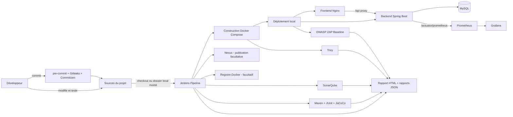
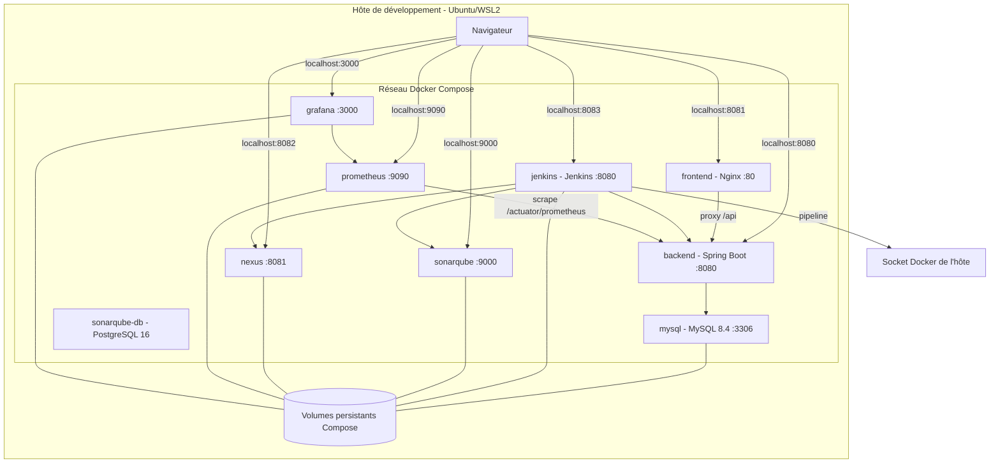
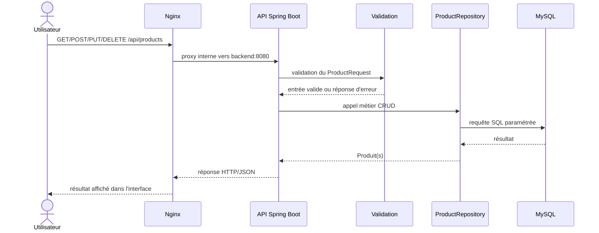

# Rapport de fin d'études

## Conception et réalisation d'une plateforme DevSecOps pour une application de catalogue

- **Projet :** DevSeCops Catalog
- **Nature :**  rapport technique
- **Filière / spécialité :** cybersécurité
- **Réalisé par :** khirallah yasmine

**Version du rapport :** 1.2 — 6 octobre 2026

> Ce rapport décrit l'implémentation présente dans le dépôt. Le build #47 est conservé comme preuve historique d'une version antérieure; les modifications ultérieures sont distinguées et leurs validations sont rapportées séparément. Les éléments institutionnels de la page de garde sont laissés à compléter, car ils ne figurent pas dans le dépôt.

---

## Résumé

Ce projet met en place un laboratoire DevSecOps local autour d'une application de gestion de produits. Il relie le développement d'une API REST, les tests automatisés, les contrôles de sécurité, la construction des artefacts et images conteneurisées, le déploiement local, la supervision et la publication d'un rapport de suivi.

Le backend est développé en Java 17 avec Spring Boot et Maven. Il expose une API CRUD et persiste les produits dans MySQL. Une interface web HTML/JavaScript est servie par Nginx, qui relaie les requêtes API vers le backend. Docker Compose orchestre les services applicatifs et, au moyen de profils, les outils complémentaires. Jenkins exécute le pipeline décrit dans le `Jenkinsfile`. Les contrôles comprennent notamment les hooks pre-commit, Gitleaks, Commitizen, les tests Maven, SonarQube, Trivy et OWASP ZAP Baseline. Nexus peut héberger le JAR. Prometheus collecte les métriques d'application et Grafana permet de les consulter.

Le rapport HTML DevSecOps est produit à chaque exécution Jenkins à partir des rapports et statuts effectivement enregistrés. Il ne répertorie que les contrôles automatisés configurés dans le laboratoire; les statuts reflètent l'exécution observée. Les scans portent sur le code de production, les dépendances, les images, la configuration du projet et l'API déployée. Les rapports ne contiennent pas de findings injectés ni de fixtures vulnérables.

Le build Jenkins #47 correspond à une exécution historique et ne valide pas le périmètre corrigé décrit ici. Le catalogue actuel contient 22 contrôles applicatifs et opérationnels. Un nouveau build Jenkins est nécessaire pour produire les rapports à jour après retrait des contrôles de fixtures; aucun nouveau résultat Jenkins n'est revendiqué dans ce document.

**Mots-clés :** DevOps, DevSecOps, CI/CD, Jenkins, Docker, Spring Boot, sécurité applicative, observabilité.

## Abstract

This project implements a local DevSecOps laboratory around a product-catalog application. It connects a REST API, automated tests, security checks, artifact and container-image builds, local deployment, monitoring, and a consolidated HTML report.

The Java 17/Spring Boot backend exposes CRUD operations and stores product data in MySQL. A small HTML/JavaScript frontend is served by Nginx, which proxies API calls to the backend. Docker Compose orchestrates the application and optional DevOps services. Jenkins runs the declarative pipeline. The implemented controls include pre-commit hooks, Gitleaks, Commitizen, Maven tests, SonarQube, Trivy, and OWASP ZAP Baseline. Nexus is available for Maven artifact publication; Prometheus and Grafana provide application metrics collection and visualization.

Jenkins build #47 is a historical execution and does not validate the revised scope described here. The current catalogue contains 22 application and operational controls. A new Jenkins build is required to produce reports reflecting removal of fixture checks; this document does not claim a new Jenkins result.

**Keywords:** DevOps, DevSecOps, CI/CD, Jenkins, Docker, Spring Boot, application security, observability.

---

## Sommaire

1. [Introduction générale](#1-introduction-générale)
2. [Contexte, problématique et objectifs](#2-contexte-problématique-et-objectifs)
3. [Périmètre et exigences](#3-périmètre-et-exigences)
4. [État de l'art et démarche DevSecOps](#4-état-de-lart-et-démarche-devsecops)
5. [Architecture globale](#5-architecture-globale)
   - [Arborescence détaillée et chemins](#55-arborescence-détaillée-du-projet-et-chemins)
6. [Conception de l'application](#6-conception-de-lapplication)
7. [Environnement technique](#7-environnement-technique)
8. [Réalisation de la chaîne CI/CD](#8-réalisation-de-la-chaîne-cicd)
   - [Détail des réalisations et chemins](#84-réalisation-détaillée-et-chemins-des-composants)
9. [Sécurité et traitement des vulnérabilités](#9-sécurité-et-traitement-des-vulnérabilités)
10. [Rapport HTML et observabilité](#10-rapport-html-et-observabilité)
   - [Génération du dashboard HTML](#103-génération-détaillée-du-dashboard-html)
   - [Structure HTML, CSS et données](#104-structure-html-css-et-données-affichées)
11. [Validation et résultats](#11-validation-et-résultats)
12. [Installation, exécution et exploitation](#12-installation-exécution-et-exploitation)
13. [Limites et risques résiduels](#13-limites-et-risques-résiduels)
14. [Améliorations proposées](#14-améliorations-proposées)
15. [Conclusion générale](#15-conclusion-générale)
16. [Glossaire](#16-glossaire)
17. [Références du projet](#17-références-du-projet)

---

## 1. Introduction générale

La livraison d'une application implique davantage que l'écriture de code. Il faut également vérifier la qualité et le comportement, maîtriser les dépendances, sécuriser les secrets, construire des artefacts identifiables, déployer de façon répétable puis rendre les résultats accessibles à l'équipe.

Le projet **DevOps Catalog** met en œuvre ce cycle à l'échelle d'un laboratoire local. Il s'appuie sur une application CRUD suffisamment petite pour rester compréhensible tout en intégrant plusieurs pratiques d'ingénierie : tests, contrôles avant commit, automatisation par pipeline, conteneurisation, scan des images, analyse dynamique limitée, stockage d'artefacts et supervision.

Le périmètre est pédagogique et local. Le système ne doit pas être assimilé à une plateforme de production : certaines mesures telles que l'authentification applicative, TLS, la haute disponibilité et la gestion industrielle des secrets ne sont pas implémentées.

## 2. Contexte, problématique et objectifs

### 2.1 Problématique

Comment automatiser, dans une seule chaîne compréhensible, les vérifications d'une application web, ses contrôles de sécurité, la création de ses artefacts et son déploiement local, tout en rendant visibles les résultats réels de chaque contrôle ?

### 2.2 Objectif général

Concevoir et réaliser une plateforme DevSecOps de démonstration qui relie le code d'une application de catalogue à un pipeline Jenkins reproductible, des contrôles automatisés et un rapport HTML exploitable.

### 2.3 Objectifs spécifiques

- Réaliser une application web CRUD avec API REST et persistance relationnelle.
- Valider les données reçues par l'API et utiliser des requêtes SQL paramétrées.
- Conteneuriser le backend et le frontend et les orchestrer avec MySQL.
- Automatiser le build, les tests, les analyses et le déploiement dans Jenkins.
- Ajouter des contrôles pré-commit et la validation de messages Conventional Commits.
- Analyser le code avec SonarQube, les images avec Trivy et l'API déployée avec ZAP Baseline.
- Stocker les artefacts Maven dans Nexus lorsque l'option est activée.
- Exposer des métriques applicatives à Prometheus et fournir Grafana.
- Produire une synthèse HTML fondée exclusivement sur les résultats effectivement produits par les outils sur l'application, ses dépendances, ses images, sa configuration et l'API déployée.

## 3. Périmètre et exigences

### 3.1 Inclus dans le périmètre

| Domaine | Réalisation |
|---|---|
| Application | Interface de catalogue et API REST de gestion des produits |
| Persistance | MySQL à l'exécution, H2 en mémoire pour les tests |
| Qualité | Compilation Maven, tests JUnit, rapport JaCoCo |
| Sécurité avant commit | Hooks pre-commit, détection de secrets par Gitleaks |
| Convention de commit | Commitizen / Conventional Commits |
| Analyse source | SonarQube et récupération des issues/hotspots |
| Sécurité des images | Trivy sur backend et frontend |
| Analyse dynamique | OWASP ZAP Baseline passif sur l'API déployée |
| Livraison | Images Docker, déploiement Compose et test HTTP |
| Artefacts | Archivage Jenkins et publication Maven Nexus optionnelle |
| Observabilité | Actuator, endpoint Prometheus, Prometheus et Grafana |
| Restitution | Dashboard HTML et rapports JSON/HTML archivés |

### 3.2 Hors périmètre

- Déploiement sur un cloud ou une infrastructure de production.
- Authentification et autorisations pour les utilisateurs de l'application.
- Revue de code humaine.
- Analyse complète des fichiers IaC, tests d'intrusion actifs ou audit de conformité.
- Haute disponibilité, stratégie de sauvegarde/restauration testée et plan de reprise.
- Publication Docker Hub obligatoire : elle est facultative et désactivée par défaut.

### 3.3 Exigences principales

**Fonctionnelles :** créer, afficher, modifier et supprimer un produit; afficher l'état de santé de l'API; présenter les résultats du pipeline et les liens vers les rapports.

**Non fonctionnelles :** démarrage reproductible, séparation des services, validation d'entrée, utilisation de requêtes paramétrées et conservation des données par volumes nommés.

## 4. État de l'art et démarche DevSecOps

Le projet organise les contrôles au plus près du cycle de vie :

1. **Pré-commit :** détecter les erreurs de formatage courantes, les clés privées et les secrets avant intégration.
2. **Commit / CI :** valider le message du commit, construire, tester et analyser le code.
3. **Acceptation :** construire les images, analyser leur contenu, déployer localement, exécuter les tests HTTP et le scan ZAP.
4. **Production / livraison :** archiver les rapports et publier éventuellement le JAR dans Nexus ou les images dans un registre Docker.
5. **Opérations :** observer les métriques exposées par l'application via Prometheus et Grafana.

La démarche ne repose pas sur un score synthétique. Le rapport centralise les statuts et constats émis par les outils, et signale séparément les étapes manuelles ou non configurées.

## 5. Architecture globale

### 5.1 Vue logique



### 5.2 Architecture de déploiement



Le fichier Compose sépare les services applicatifs des services complémentaires à l'aide de profils. Le profil `devops` regroupe Jenkins, SonarQube, sa base PostgreSQL et Nexus. Le profil `monitoring` regroupe Prometheus et Grafana. Les données persistantes sont conservées dans des volumes nommés.

### 5.3 Flux d'une requête applicative



### 5.4 Structure du dépôt

| Chemin | Responsabilité |
|---|---|
| `backend/src/main/java/...` | Contrôleurs, service, modèle, validation et accès SQL |
| `backend/src/test/...` | Tests automatisés du backend |
| `backend/pom.xml` | Dépendances, plugins Maven, tests et JaCoCo |
| `frontend/index.html` | Interface du catalogue, formulaire et appels à l'API |
| `frontend/nginx.conf` | Service statique et proxy `/api/` |
| `Jenkinsfile` | Définition déclarative des étapes CI/CD |
| `docker-compose.yml` | Services, profils, ports, healthchecks et volumes |
| `jenkins/` | Image Jenkins personnalisée et configuration initiale du job |
| `monitoring/` | Configuration et images Prometheus/Grafana |
| `devsecops_report.py` | Initialisation, collecte et génération de la dashboard |
| `sonarqube_report.py` | Extraction paginée des issues et hotspots SonarQube |
| `reports/` | Rapports exportés d'une exécution Jenkins |
| `.pre-commit-config.yaml` | Hooks de contrôle de fichiers et hook Commitizen |
| `THREAT-MODEL.md` | Analyse STRIDE simplifiée du laboratoire |

### 5.5 Arborescence détaillée du projet et chemins

L'arborescence ci-dessous présente les fichiers sources pertinents pour reproduire le projet. Les répertoires générés (`backend/target/`, caches, volumes Docker et fichiers `.pyc`) sont des résultats d'exécution et non du code source à maintenir.

Dans l'environnement utilisé pour le projet, la racine Windows est `D:\5NIDS\Labs Cybersecurity and Coding\DevOps_Project\devops-platform`; le chemin équivalent depuis Ubuntu/WSL est `/mnt/d/5NIDS/Labs Cybersecurity and Coding/DevOps_Project/devops-platform`. Tous les chemins de l'arborescence suivante sont relatifs à cette racine.

```text
devops-platform/
├── backend/
│   ├── Dockerfile
│   ├── pom.xml
│   └── src/
│       ├── main/
│       │   ├── java/com/example/devops/
│       │   │   ├── Application.java
│       │   │   ├── ApiController.java
│       │   │   ├── ApiExceptionHandler.java
│       │   │   ├── Product.java
│       │   │   ├── ProductController.java
│       │   │   ├── ProductNotFoundException.java
│       │   │   ├── ProductRepository.java
│       │   │   ├── ProductRequest.java
│       │   │   ├── ProductService.java
│       │   │   └── SecurityHeadersFilter.java
│       │   └── resources/
│       │       ├── application.properties
│       │       └── schema.sql
│       └── test/
│           ├── java/com/example/devops/ProductControllerTest.java
│           └── resources/application-test.properties
├── frontend/
│   ├── Dockerfile
│   ├── index.html
│   └── nginx.conf
├── jenkins/
│   ├── Dockerfile
│   └── init.groovy.d/
│       ├── security.groovy
│       └── zz-pipeline.groovy
├── monitoring/
│   ├── grafana/Dockerfile
│   ├── grafana/provisioning/datasources/prometheus.yml
│   ├── prometheus/Dockerfile
│   └── prometheus/prometheus.yml
├── tests/
│   ├── test_devsecops_checks.py
│   ├── test_devsecops_report.py
│   └── test_sonarqube_report.py
├── reports/                         # rapports locaux, régénérables
├── .pre-commit-config.yaml
├── docker-compose.yml
├── devsecops_checks.py
├── devsecops_report.py
├── Jenkinsfile
├── sonarqube_report.py
├── setup.sh / up.sh / down.sh / status.sh
├── README.md
├── THREAT-MODEL.md
└── RAPPORT-FIN-ETUDES.md
```

**Chemins à connaître pour la réalisation :**

| Besoin | Chemin source | Produit ou effet |
|---|---|---|
| Pipeline CI/CD et enchaînement des étapes | `Jenkinsfile` | Résultats d'étapes, artefacts archivés, build Jenkins |
| Catalogue, statut et génération HTML/CSS | `devsecops_report.py` | `reports/devsecops-results.json`, `reports/devsecops-report.html`, `reports/devsecops-report.css` |
| Contrôles runtime, Compose et supervision | `devsecops_checks.py` | Rapports JSON de contrôles dans `reports/` |
| Récupération des constats SonarQube | `sonarqube_report.py` | `reports/sonarqube-issues.json`, `reports/sonarqube-hotspots.json` |
| Code de l'API | `backend/src/main/java/com/example/devops/` | JAR sous `backend/target/` et image backend |
| Interface navigateur et proxy API | `frontend/index.html`, `frontend/nginx.conf` | Image frontend Nginx |
| Services, profils, réseaux et volumes | `docker-compose.yml` | Environnement Docker Compose |
| Supervision applicative | `backend/src/main/resources/application.properties`, `monitoring/` | Endpoint Prometheus, configuration Prometheus/Grafana |
| Tests de non-régression | `tests/`, `backend/src/test/` | Résultats `unittest` et Surefire/JUnit |

## 6. Conception de l'application

### 6.1 Architecture logicielle

Le backend suit une séparation en couches :

- **ProductController :** expose les routes REST et délègue le traitement.
- **ProductService :** porte la logique applicative et transforme les absences en erreurs métier.
- **ProductRepository :** exécute les opérations JDBC sur la base.
- **Product / ProductRequest :** distinguent les données retournées des données entrantes validées.
- **ApiExceptionHandler :** uniformise le traitement des exceptions API.

### 6.2 Modèle de données

Un produit comporte les propriétés suivantes :

| Attribut | Type logique | Règle d'entrée |
|---|---|---|
| `id` | Identifiant numérique | Généré par la base |
| `name` | Texte | Obligatoire, non blanc, longueur maximale 120 |
| `description` | Texte | Facultatif, longueur maximale 1000 |
| `price` | Décimal | `@DecimalMin` impose une valeur strictement supérieure à zéro lorsqu'elle est présente |
| `stock` | Entier | Supérieur ou égal à zéro |

La base est initialisée à partir du schéma SQL fourni avec le backend. Les tests Maven utilisent H2 en mémoire, tandis que l'exécution Compose utilise MySQL.

### 6.3 API

| Méthode | Route | Rôle |
|---|---|---|
| `GET` | `/api/health` | État de santé applicatif utilisé par l'interface et le pipeline |
| `GET` | `/api/products` | Liste des produits |
| `GET` | `/api/products/{id}` | Consultation d'un produit |
| `POST` | `/api/products` | Création, avec réponse `201 Created` |
| `PUT` | `/api/products/{id}` | Mise à jour |
| `DELETE` | `/api/products/{id}` | Suppression, avec réponse `204 No Content` |
| `GET` | `/actuator/health` | Healthcheck Spring Actuator |
| `GET` | `/actuator/prometheus` | Métriques pour Prometheus |

### 6.4 Sécurité des entrées et de la base

Les objets de requête utilisent les contraintes Bean Validation. L'API s'appuie sur `@Valid` avant les opérations de création et de mise à jour. Le dépôt JDBC utilise des paramètres (`?`) et des instructions préparées pour les valeurs des requêtes SQL. Les noms de produits sont normalisés par suppression des espaces périphériques avant écriture.

**Point de durcissement identifié :** `ProductRequest.price` porte `@DecimalMin` mais pas `@NotNull`. Une valeur absente ou `null` peut donc ne pas être rejetée par cette contrainte avant d'atteindre la persistance; un contrôle de nullité explicite et un test d'API correspondant sont à ajouter pour rendre le contrat serveur complet.

## 7. Environnement technique

| Composant | Technologie / version déclarée | Usage |
|---|---|---|
| Langage backend | Java 17 | API et logique applicative |
| Framework backend | Spring Boot 3.5.16 | API REST, validation, JDBC, Actuator |
| Build | Maven | Compilation, tests et empaquetage JAR |
| Base applicative | MySQL 8.4 | Stockage des produits |
| Base de test | H2 | Tests sans dépendance à MySQL externe |
| Frontend | HTML, CSS, JavaScript | Interface web légère |
| Serveur web / proxy | Nginx | Fichiers statiques et relais de l'API |
| Conteneurs | Docker, Docker Compose | Construction et orchestration |
| CI/CD | Jenkins | Orchestration pipeline |
| SAST | SonarQube | Analyse statique Java et hotspots |
| Scan images | Trivy | Vulnérabilités HIGH/CRITICAL corrigeables |
| DAST passif | OWASP ZAP Baseline 2.17.0 | Analyse passive de l'API déployée |
| Secrets / hooks | pre-commit, Gitleaks | Contrôles avant intégration |
| Messages Git | Commitizen 4.8.3 | Conventional Commits |
| Dépôt Maven | Nexus Repository | Publication facultative du JAR |
| Métriques | Prometheus et Grafana | Collecte et exploration des métriques |
| Couverture | JaCoCo 0.8.12 | Rapport de couverture de tests |

Les dépendances, versions configurées et images se vérifient dans les fichiers de configuration correspondants. Les services n'ont pas tous une version exacte fixée de la même manière; le présent rapport ne suppose pas qu'une version non explicitement verrouillée soit immuable.

## 8. Réalisation de la chaîne CI/CD

### 8.1 Vue du pipeline

```mermaid
flowchart TD
    Start[Déclenchement Jenkins] --> Source[Source locale ou checkout SCM]
    Source --> Init[Initialisation des résultats]
    Init --> Pre[Hooks pre-commit]
    Pre --> Leak[Gitleaks dédié]
    Leak --> Commit[Validation Commitizen]
    Commit --> Clean[Maven clean]
    Clean --> Package[Construction du JAR]
    Package --> Tests[Tests JUnit et rapport JaCoCo]
    Tests --> Updates[Rapport des mises à jour Maven]
    Updates --> IaC[Trivy Config sur la configuration du projet]
    IaC --> Sonar[SonarQube si RUN_SONAR]
    Sonar --> Images[Construction des images backend/frontend]
    Images --> ComposeCheck[Contrôle Compose et secrets locaux]
    ComposeCheck --> Trivy[Scan Trivy des images]
    Trivy --> Nexus{PUBLISH_NEXUS ?}
    Nexus -->|Oui| PublishJar[Publication Maven dans Nexus]
    Nexus -->|Non| DockerOpt
    PublishJar --> DockerOpt{PUBLISH_DOCKER ?}
    DockerOpt -->|Oui| PublishImage[Publication au registre]
    DockerOpt -->|Non| Deploy
    PublishImage --> Deploy[Déploiement Compose et attente healthchecks]
    Deploy --> Runtime[Healthchecks, durcissement et security smoke tests]
    Runtime --> Recovery[Redémarrage contrôlé et readiness]
    Recovery --> Monitoring[Prometheus/Grafana]
    Monitoring --> Zap[ZAP Baseline passif]
    Zap --> Html[Dashboard HTML + CSS + archivage]
    Html --> Email{Destinataire email configuré ?}
    Email -->|Oui| Notify[Notification après succès]
    Email -->|Non| End[Fin]
    Notify --> End
```



### 8.2 Étapes et contrôles

1. **Vérification de l'environnement :** vérifie la présence de Java, Maven, Git, pre-commit, Trivy, Docker Compose, curl et Python.
2. **Récupération des sources :** copie le dossier monté en mode local, en excluant notamment `.env`, `.git`, les sorties Maven et les anciens rapports; ou exécute `checkout scm`.
3. **Initialisation du rapport :** remet à zéro les résultats et prépare le catalogue des contrôles.
4. **Pre-commit :** exécute tous les hooks configurés sur tous les fichiers, y compris Gitleaks.
5. **Gitleaks dédié :** relance le scanner afin de rendre son statut visible séparément dans le rapport.
6. **Commitizen :** contrôle le dernier message de commit réel en mode SCM; en mode dossier local, marque le contrôle comme ignoré puisqu'aucun historique Git n'est fourni.
7. **Build Maven :** nettoie puis produit le JAR.
8. **Tests :** lance les tests unitaires/sécurité, publie le rapport JUnit et archive le JAR et JaCoCo.
9. **Rapport de mises à jour :** lance Maven Versions et archive les mises à jour candidates sans modifier automatiquement le POM.
10. **Trivy Config :** analyse la configuration IaC effectivement présente dans le projet; les findings sont conservés dans `reports/trivy-iac.json`.
11. **SonarQube :** analyse le code source applicatif backend si `RUN_SONAR` est activé; `sonarqube_report.py` récupère issues et hotspots par API.
12. **Images Docker :** construit les images backend et frontend depuis leurs Dockerfiles.
13. **Configuration IaC résolue :** contrôle la configuration Compose, les services attendus, les privilèges, les ports, la gestion du `.env` et les redémarrages.
14. **Trivy image :** analyse les images construites pour les vulnérabilités HIGH/CRITICAL avec correctif disponible; les findings bloquants interrompent le stage et les journaux facilitent le diagnostic.
15. **Nexus facultatif :** publie le JAR si `PUBLISH_NEXUS` est activé et que les credentials et le dépôt sont opérationnels.
16. **Publication d'images facultative :** pousse les images si `PUBLISH_DOCKER` est activé et qu'un dépôt et des credentials sont fournis.
17. **Déploiement :** démarre MySQL, backend et frontend avec Compose puis attend leur état disponible.
18. **Contrôles post-déploiement :** vérifie healthchecks, sécurité HTTP, identité non-root et disponibilité des endpoints; redémarre aussi le backend pour contrôler sa reprise.
19. **Supervision et DAST :** vérifie la cible Prometheus et la santé Grafana, puis lance OWASP ZAP Baseline sur l'API.
20. **Publication :** génère le JSON consolidé, le HTML et son CSS, publie le rapport avec HTML Publisher et archive les artefacts.
21. **Notification facultative :** envoie un email après succès si un destinataire et la configuration SMTP sont disponibles.

### 8.3 Paramètres Jenkins

| Paramètre | Valeur/usage |
|---|---|
| `USE_LOCAL_SOURCE` | `true` par défaut; choisir les sources du dossier monté plutôt qu'un checkout SCM |
| `RUN_SONAR` | `true` par défaut; nécessite le credential Jenkins `sonar-token` |
| `PUBLISH_NEXUS` | `true` par défaut; nécessite `nexus-credentials` et un dépôt hosted configuré |
| `PUBLISH_DOCKER` | `false` par défaut; protège contre une publication externe involontaire |
| `DOCKERHUB_REPOSITORY` | Préfixe des dépôts backend/frontend si publication Docker activée |
| `JENKINS_PUBLIC_URL` | Base d'URL utilisée dans les liens de dashboard |
| `EMAIL_TO` | Facultatif; nécessite une configuration SMTP Jenkins |

Les identifiants sont injectés via Jenkins Credentials lorsqu'ils sont utilisés; les mots de passe locaux de démonstration de `.env.example` ne sont pas adaptés à un environnement partagé.

### 8.4 Réalisation détaillée et chemins des composants

La chaîne est déclarée dans `Jenkinsfile`; ce fichier est le point d'entrée exécutable et non une simple illustration. Le job est créé à l'initialisation par `jenkins/init.groovy.d/zz-pipeline.groovy`, tandis que `jenkins/init.groovy.d/security.groovy` porte les réglages de sécurité Jenkins du laboratoire. Le contrôleur construit son environnement depuis `jenkins/Dockerfile`, et le pipeline partage le dépôt local monté en lecture seule sous `/workspace` lorsque `USE_LOCAL_SOURCE=true`.

| Étape de réalisation | Code/chemin | Résultat concret |
|---|---|---|
| Hooks avant commit et CI | `.pre-commit-config.yaml` | Espaces, YAML, conflits, clé privée, taille de fichier, Gitleaks et Commitizen |
| Application métier | `backend/src/main/java/com/example/devops/` | API CRUD avec contrôleurs, service, repository JDBC, modèle, validation et gestion d'erreurs |
| Schéma et options d'exécution | `backend/src/main/resources/schema.sql`, `application.properties` | Table applicative, health probes et exposition des métriques Prometheus |
| Tests application | `backend/src/test/java/com/example/devops/ProductControllerTest.java` | CRUD, validation des entrées, requête SQL-like comme donnée et headers |
| Dépendances et packaging | `backend/pom.xml` | Spring Boot, JDBC, validation, MySQL, H2 de test, JaCoCo et empaquetage JAR |
| Construction backend | `backend/Dockerfile` | Build Maven multicouche et exécution sous utilisateur `app` |
| UI et proxy | `frontend/index.html`, `frontend/nginx.conf`, `frontend/Dockerfile` | Interface statique et proxy Nginx vers le backend |
| Orchestration | `docker-compose.yml` | Réseau, services, ports locaux, healthchecks, profils et volumes persistants |
| Vérifications transverses | `devsecops_checks.py` | Contrôles Compose, runtime, headers et monitoring, sérialisés en JSON |
| Agrégation SonarQube | `sonarqube_report.py` | API paginée d'issues/hotspots, rapports expurgés du jeton |
| Rapport consommé par le dashboard | `devsecops_report.py` | Initialisation, enregistrement, extraction des preuves et rendu HTML/CSS |
| Données de build visibles | `reports/` dans le workspace Jenkins | JSON/XML/logs bruts réellement liés aux contrôles du build courant |
| Observabilité | `monitoring/prometheus/`, `monitoring/grafana/` | Scrape Prometheus et datasource Grafana provisionnée |

Le pipeline utilise des blocs `post { success / failure }` pour enregistrer un résultat explicite, même lorsqu'un scanner échoue. Les étapes globales `post { always { ... } }` tentent enfin de publier un rapport de la même exécution, ce qui permet de diagnostiquer un échec sans transformer un stage absent en succès. Le paramètre `RUN_SONAR` et les options Nexus/Docker pilotent les actions correspondantes; les contrôles hors périmètre ou outils absents ne sont pas ajoutés au catalogue.

## 9. Sécurité et traitement des vulnérabilités

### 9.1 Contrôles automatisés

| Contrôle | Outil | Objectif | Politique observée |
|---|---|---|---|
| Espaces de fin et fin de fichier | pre-commit-hooks | Cohérence des fichiers | Corrige/échoue selon le hook |
| Syntaxe YAML | pre-commit-hooks | Éviter les configurations YAML invalides | Bloquant si invalide |
| Conflits de fusion | pre-commit-hooks | Détecter les marqueurs résiduels | Bloquant |
| Clés privées | pre-commit-hooks | Éviter l'ajout accidentel de clés | Bloquant |
| Fichiers volumineux | pre-commit-hooks | Refuser au-delà de 1 Mo | Bloquant |
| Secrets | Gitleaks | Détecter des secrets dans les fichiers suivis | Bloquant |
| Message de commit | Commitizen | Appliquer Conventional Commits | Bloquant au hook `commit-msg` |
| Qualité / vulnérabilités source | SonarQube | Analyse Java | Rapport d'issues et hotspots |
| Dépendances des images | Trivy | Identifier les vulnérabilités d'images | Seuil bloquant HIGH/CRITICAL corrigeables |
| API déployée | OWASP ZAP Baseline | Scan passif HTTP | Alerte WARN rapportée; erreurs/FAIL bloquants |

**Remarque sur SCA :** Trivy analyse les images et les composants Java embarqués; ces résultats sont présentés dans les contrôles SCA et Trivy du tableau de bord.

### 9.2 Modèle de menace STRIDE

Le modèle présent dans `THREAT-MODEL.md` couvre le laboratoire Docker Compose, non un environnement de production.

| Menace | Exemple | Contrôle ou limite |
|---|---|---|
| Spoofing | Appelant non autorisé modifiant le catalogue | L'application n'a pas d'authentification; ne pas exposer à un réseau non fiable |
| Tampering | Valeur malformée ou entrée SQL-like | Validation des requêtes, JDBC paramétré et tests |
| Repudiation | Difficulté à rattacher un déploiement à une modification | Historique Git et enregistrements Jenkins; revue PR recommandée |
| Information disclosure | Secret dans Git, logs ou endpoint exposé | `.env` ignoré, Gitleaks, credentials Jenkins; ne pas publier de secrets |
| Denial of service | Entrées excessives ou trop grand nombre de requêtes | Limites de taille/range sur les champs; rate limiting absent |
| Elevation of privilege | Job Jenkins contrôlant l'hôte Docker | Socket Docker monté et Jenkins root dans ce laboratoire; accès à réserver à des utilisateurs de confiance |

### 9.3 Portée des résultats affichés

Les contrôles de sécurité ne sont exécutés que sur le code de production backend, ses dépendances résolues, les images backend/frontend effectivement construites, la configuration du projet et l'API déployée. Les scanners ne reçoivent aucun dépôt d'exemple vulnérable et le générateur ignore les anciens rapports de fixtures. Les tests unitaires restent des tests de non-régression de l'application; ils ne créent pas de findings dans la dashboard.

Un résultat `passed` indique que l'étape de contrôle a terminé selon son critère, pas qu'elle n'a détecté aucune vulnérabilité. Les constats sont extraits des artefacts de scanner associés au build. Une étape non lancée ou sans rapport demeure non exécutée/manquante; l'absence de constat ne garantit pas l'absence absolue de vulnérabilité. Les builds Jenkins antérieurs conservent leurs pages historiques et leurs artefacts; ils ne reflètent pas le périmètre actuel et ne doivent pas être utilisés comme dashboard courante. Un nouveau build est nécessaire pour obtenir les résultats du périmètre corrigé.

### 9.4 Mesures de sécurisation de la chaîne

- Le jeton SonarQube est fourni par un credential Jenkins et l'extraction API se fait par `sonarqube_report.py`; le jeton n'est pas écrit dans un rapport.
- Le login Docker utilise `--password-stdin`, puis effectue un `docker logout`.
- Les fichiers de configuration et rapports ne doivent pas contenir de secrets réels.
- Le CSS de la dashboard est externe afin de respecter la CSP Jenkins stricte sans assouplir la politique.
- Le rapport est limité aux contrôles automatisés configurés dans ce laboratoire et aux résultats réellement produits.

## 10. Rapport HTML et observabilité

### 10.1 Dashboard de suivi

À la fin d'un build, `devsecops_report.py` génère `reports/devsecops-report.html` ainsi que `reports/devsecops-report.css`. Le pipeline publie le HTML avec le plugin Jenkins HTML Publisher et archive aussi les résultats JSON et rapports spécialisés.

Les sections de la dashboard comprennent :

- une vue générale de la couverture et des résultats;
- la navigation entre les phases de suivi DevSecOps;
- pour chaque outil, son objectif, le résumé d'exécution, la commande, les mesures extraites de ses rapports et les liens vers les artefacts;
- les findings issus des rapports disponibles;
- un plan d'action établi à partir des findings présents;
- les statuts des contrôles configurés pour le laboratoire.

Les constats agrégés proviennent exclusivement des artefacts d'analyse du code de production, des dépendances, des images livrables, de la configuration réellement utilisée et de l'API déployée. L'absence de finding dans une exécution est affichée comme telle, sans affirmer l'absence absolue de vulnérabilités. Les dashboards de builds anciens restent des archives historiques; relancer le pipeline après les changements est nécessaire pour obtenir le périmètre courant.

### 10.2 Prometheus et Grafana

Spring Actuator expose `/actuator/prometheus`. La configuration Prometheus scrute `backend:8080` toutes les 15 secondes. Grafana est configuré pour utiliser Prometheus comme source de données. Les identifiants Grafana proviennent des variables `GRAFANA_ADMIN_USER` et `GRAFANA_ADMIN_PASSWORD` du fichier `.env` (valeurs locales de démonstration par défaut).

La supervision des métriques applicatives est distincte du rapport Jenkins : Prometheus/Grafana observe des métriques de fonctionnement, tandis que la dashboard HTML consolide les contrôles et findings d'une exécution CI/CD.

### 10.3 Génération détaillée du dashboard HTML

Le dashboard est généré automatiquement à chaque build Jenkins par `devsecops_report.py`; il ne doit pas être modifié manuellement dans `reports/`, car le fichier est remplacé au prochain build. La génération se déroule en quatre phases :

1. **Initialiser le catalogue.** Après le checkout ou la copie locale, Jenkins supprime les anciens rapports du workspace de build, puis lance `devsecops_report.py init`. La liste `CONTROLS` dans le script est la source de vérité des 22 contrôles, de leur phase, de leur libellé et de leur objectif. Un résultat neuf commence à `not_run`, et ne sera considéré exécuté que lorsqu'un stage l'enregistre.
2. **Enregistrer les sorties de chaque stage.** Le Jenkinsfile appelle `record` pour un contrôle individuel et `record-check-report` pour les vérifications groupées de `devsecops_checks.py`. Chaque enregistrement contient notamment l'identifiant stable, le statut, un résumé, la commande, l'heure et les chemins des artefacts. Les preuves techniques détaillées restent dans leurs rapports JSON/XML/logs.
3. **Interpréter les rapports associés.** `control_evidence()` extrait notamment les compteurs de tests Surefire, les hooks passés, les findings SonarQube et Trivy, les alertes ZAP et les résultats des contrôles runtime. `load_vulnerabilities()` normalise les constats et sévérités puis les relie aux artefacts explicitement associés aux contrôles de cette exécution. Il n'importe pas un ancien JSON seulement parce que le fichier existe dans le dossier.
4. **Rendre, publier et archiver.** Le bloc global `post { always { ... } }` de `Jenkinsfile` passe le numéro, l'URL et le résultat du build au générateur. Le plugin HTML Publisher expose le rapport sous **Dashboard DevSecOps** et Jenkins archive les rapports détaillés.

La commande réellement utilisée par le pipeline est :

```bash
python3 devsecops_report.py generate \
  --results reports/devsecops-results.json \
  --output reports/devsecops-report.html \
  --build-number "$BUILD_NUMBER" \
  --build-url "$DEVSECOPS_BUILD_URL" \
  --build-result "$DEVSECOPS_BUILD_RESULT"
```

Les mêmes sous-commandes sont utilisables localement :

```bash
python3 devsecops_report.py init \
  --project-root . \
  --results reports/devsecops-results.json

python3 devsecops_report.py record \
  --id maven-tests \
  --status passed \
  --summary "Les tests unitaires et de sécurité Maven sont passés." \
  --command "mvn -B test jacoco:report" \
  --artifact reports/maven-tests.xml \
  --results reports/devsecops-results.json

python3 devsecops_report.py generate \
  --results reports/devsecops-results.json \
  --output reports/devsecops-report.html
```

### 10.4 Structure HTML, CSS et données affichées

Le fichier généré `reports/devsecops-report.html` est un document HTML5 en français. Sa structure visible comporte un titre et la date de génération, un menu latéral, une synthèse, des cartes par phase, un tableau de contrôles pour chaque phase, la table des findings, le plan d'action et une note de périmètre.

```text
html
└── body
    ├── header                    titre, portée et date
    └── .dashboard-layout
        ├── aside.side-menu       liens d'ancrage internes
        └── main
            ├── section#overview statuts, couverture, build et sévérités
            ├── section#phases   liens vers les 5 phases
            ├── section#phase-1  pré-commit
            ├── section#phase-2  commit / CI
            ├── section#phase-3  acceptation
            ├── section#phase-4  production
            ├── section#phase-5  opérations
            ├── section#findings findings triés par sévérité
            ├── section#actions  recommandations issues des constats
            └── section#scope    limites d'interprétation
```

Chaque ligne du tableau associe le statut enregistré, le nom et l'objectif de l'outil, le résumé du stage, la commande, les métriques trouvées dans le rapport source, la prochaine action, les liens d'artefacts et l'heure de vérification. Les statuts sont déterminés par les stages (`passed`, `failed`, `blocked`, `skipped`, `manual`, `not_run`); la génération ne suppose pas qu'un contrôle a réussi si son résultat est absent.

Les sorties liées ont le schéma opérationnel suivant (les champs `pipeline` sont ajoutés lors de la génération Jenkins) :

```json
{
  "schema_version": 1,
  "generated_at": "date ISO-8601",
  "pipeline": {
    "build_number": "numéro Jenkins",
    "build_url": "URL du build",
    "build_result": "SUCCESS ou FAILURE"
  },
  "results": [
    {
      "id": "maven-tests",
      "phase": "Commit (CI)",
      "tool": "Tests unitaires et sécurité Maven",
      "status": "passed",
      "summary": "Résumé réellement enregistré par le stage",
      "command": "mvn -B test jacoco:report",
      "artifacts": ["reports/maven-tests.xml"],
      "checked_at": "date ISO-8601"
    }
  ]
}
```

Pour produire la page, `generate()` ordonne les résultats selon le catalogue `CONTROLS`, calcule les compteurs par statut et phase, appelle les extracteurs de preuves, puis échappe les valeurs textuelles et attributs injectés dans le HTML. Les données de rapport sont des données, et non du balisage exécutable. Les paths de rapports ne donnent un lien que si la cible se trouve dans l'espace d'artefacts attendu.

Chaque lien du tableau ouvre le fichier original associé dans le même onglet : les données SonarQube et Trivy restent en JSON, les sorties en log/XML restent dans leur format natif, et le rapport ZAP ouvre son HTML d'origine (`zap-report.html`). La fonction `safe_link()` vérifie que le fichier déclaré existe dans la racine des rapports. Dans la page publiée par HTML Publisher, les liens d'artefact utilisent `../artifact/<chemin>` : le navigateur les résout sur le même hôte et le même contexte Jenkins, vers les artefacts de la même exécution, sans dépendre d'une adresse codée en dur comme `localhost`. En exécution locale, le script conserve un lien relatif au dossier de rapports. Le `Jenkinsfile` archive tout `reports/**` pour que les destinations Artifact soient présentes dans chaque build. Gitleaks publie un compte-rendu synthétique sans donnée sensible; les tests smoke et de reprise archivent leurs sorties réelles. Sur petit écran, les colonnes secondaires sont masquées pour maintenir visibles les boutons de rapport.

Le gabarit HTML est défini dans `devsecops_report.py` (fonction `generate`) et rendu sans JavaScript. Le style intégré au gabarit de construction est extrait pendant la génération vers `reports/devsecops-report.css`; le HTML livré le référence par `<link rel="stylesheet" href="devsecops-report.css">`. Les classes `.width-0` à `.width-100` traduisent les jauges calculées en CSS sans attribut de style dynamique. Le menu utilise des ancres HTML ordinaires et le tableau possède un conteneur défilant sur petit écran. Cette sortie avec CSS externe et sans script inline est adaptée à la politique CSP restrictive de Jenkins.

Extrait représentatif de la structure finale (les valeurs réelles sont produites depuis le JSON, pas codées en dur) :

```html
<header>
  <h1>Suivi des contrôles DevSecOps</h1>
  <p>Vue globale des cinq phases DevSecOps — dernière génération : …</p>
</header>
<div class="dashboard-layout">
  <aside class="side-menu">
    <nav class="menu-links" aria-label="Navigation du tableau de bord">
      <a href="#overview">Vue générale</a>
      <a href="#phases">Phases DevSecOps</a>
      <a href="#findings">Findings</a>
      <a href="#actions">Plan d'action</a>
      <a href="#scope">Périmètre</a>
    </nav>
  </aside>
  <main>
    <section id="overview">…synthèse et sévérités…</section>
    <section id="phase-2">
      <table>
        <thead><tr><th>État</th><th>Contrôle</th>
          <th>Commande / détails</th><th>Prochaine action</th>
          <th>Rapport</th><th>Vérifié le</th></tr></thead>
        <tbody><!-- une ligne par contrôle enregistré --></tbody>
      </table>
    </section>
    <section id="findings">…constats liés aux artefacts…</section>
    <section id="actions">…remédiations contextualisées…</section>
  </main>
</div>
```

Les résultats sont conservés avec les rapports suivants dans `reports/` puis dans les artefacts Jenkins : `devsecops-results.json`, `devsecops-report.html`, `devsecops-report.css`, `maven-tests.xml`, les rapports SonarQube, Trivy, ZAP et les JSON de contrôles. Ainsi, HTML lisible, données agrégées et preuves brutes restent liés au même numéro de build.

## 11. Validation et résultats

### 11.1 Historique Jenkins

Le **build Jenkins #47** est un instantané historique d'un ancien périmètre. Il n'est pas une preuve de l'état actuel et ses artefacts ne sont pas la dashboard courante. Jenkins conserve ces anciens builds; pour lire uniquement les résultats de l'application après le retrait des contrôles de démonstration, il faut lancer un nouveau build avec le Jenkinsfile modifié.

### 11.2 Vérifications locales récentes

Les sources actuelles définissent **22 contrôles** dans `CONTROLS` de `devsecops_report.py`. La suite de tests locale est la validation du générateur; elle n'est pas un résultat de scan Jenkins.

| Vérification récente | Résultat | Portée et interprétation |
|---|---|---|
| Suite de tests Python | **23 tests réussis** | Vérifie les contrôles, la génération HTML, les liens, les artefacts, les filtres de findings et le rendu SonarQube limité au code de production |
| Tests Maven du backend | **5 tests réussis** | `mvn clean test` exécuté localement après suppression du test de démonstration |
| Nouveaux scans Jenkins du périmètre applicatif | Pas encore exécutés | À lancer pour produire une dashboard actuelle fondée uniquement sur l'application livrée |

### 11.3 Périmètre et règles de preuve

Le dashboard actuel catalogue les 22 contrôles automatisés déclarés dans `devsecops_report.py`. Le pourcentage de couverture y signifie « contrôles avec résultat / contrôles configurés »; il ne représente ni la couverture du code JaCoCo, ni le pourcentage de sécurité. Pour chaque mesure, le générateur exige la correspondance avec un artefact déclaré par le contrôle, évitant de réutiliser un rapport ancien présent sur disque. Un rapport absent est signalé comme manquant et n'est pas interprété comme zéro finding. Une étape `not_run` indique de consulter le premier stage Jenkins en échec.

Les preuves sont conservées sous `reports/` dans le workspace du build : JUnit/Surefire XML, rapports JSON Trivy/SonarQube/contrôles, rapports JSON/HTML ZAP, logs pre-commit et de scan, résultats agrégés JSON, HTML final, CSS et rapport STRIDE. Jenkins archive ces fichiers avec le build pour maintenir le lien entre résultat consolidé et artefacts sources.

### 11.4 Validation d'intégration restant à effectuer

La prochaine validation complète consiste à lancer `devops-catalog` dans Jenkins avec `USE_LOCAL_SOURCE=true`, vérifier les 22 contrôles, s'assurer que les rapports SonarQube, Trivy et ZAP ne couvrent que les sources et services livrés, puis vérifier que le build entier termine avec le résultat attendu. Tant que ce build n'a pas eu lieu, aucun nouveau résultat Jenkins ne doit être revendiqué.

Après le build, vérifier le lien **Dashboard DevSecOps** dans Jenkins et comparer la carte des contrôles avec les chemins présents sous **Artifacts**. La version HTML locale peut être régénérée séparément depuis les rapports d'un même build à l'aide de la commande donnée en section 10; il ne faut pas mélanger des rapports venant de builds différents.

## 12. Installation, exécution et exploitation

### 12.1 Prérequis

L'environnement documenté est Ubuntu sous WSL2 avec Java 17, Maven, Git, Python 3, Docker Engine et Docker Compose v2. La pile complète consomme des ressources importantes; le README recommande au minimum 8 Go de RAM pour Ubuntu/WSL, davantage si tous les outils sont lancés simultanément. SonarQube nécessite également un `vm.max_map_count` adapté.

### 12.2 Démarrage

Depuis la racine du dépôt, dans Ubuntu/WSL :

```bash
bash ./setup.sh                 # application et base de données
bash ./setup.sh --tools         # application + Jenkins, SonarQube, Nexus
bash ./setup.sh --monitoring    # application + Prometheus, Grafana
bash ./setup.sh --all           # tous les profils
```

Au démarrage, Jenkins charge le job `devops-catalog` depuis `/workspace/Jenkinsfile`; après modification de ce fichier, redémarrer Jenkins avec `docker compose --profile devops restart jenkins`, puis lancer **Build Now** pour exécuter la nouvelle définition. En mode dossier monté, conserver `USE_LOCAL_SOURCE=true`. En mode dépôt Git, configurer un job Pipeline from SCM, puis désactiver cette option.

### 12.3 Contrôles locaux

Depuis la racine du dépôt, lancer les hooks puis la suite de vérification Maven :

```bash
pre-commit run --all-files
cd backend
mvn -B clean verify
```

La première commande contrôle les fichiers selon `.pre-commit-config.yaml`; la seconde compile, lance les tests et produit le JAR et le rapport JaCoCo.

### 12.4 Vérification de l'état

```bash
bash ./status.sh
curl --fail http://localhost:8080/api/health
docker compose logs -f backend
docker compose logs -f jenkins
```

### 12.5 Arrêt et conservation des données

```bash
bash ./down.sh
```

Le script arrête les services avec `docker compose --profile '*' down` et conserve les volumes. Pour supprimer aussi les volumes et donc les données MySQL/Jenkins/Nexus/SonarQube/Prometheus/Grafana, une commande destructive distincte existe :

```bash
docker compose down -v
```

Ne pas exécuter cette dernière si les données du laboratoire doivent être conservées.

### 12.6 Adresses locales

| Service | URL |
|---|---|
| Interface catalogue | `http://localhost:8081` |
| API | `http://localhost:8080` |
| Jenkins | `http://localhost:8083` |
| SonarQube | `http://localhost:9000` |
| Nexus | `http://localhost:8082` |
| Prometheus | `http://localhost:9090` |
| Grafana | `http://localhost:3000` |

## 13. Limites et risques résiduels

1. **Jenkins et Docker :** Jenkins s'exécute en root et reçoit le socket Docker de l'hôte. Un pipeline compromis peut donc contrôler l'hôte; la configuration doit rester confinée à un laboratoire local de confiance.
2. **Authentification applicative :** l'API n'impose pas d'identité utilisateur ni de rôles. Elle ne doit pas être exposée à un réseau non fiable.
3. **Complétude de validation :** le prix ne porte pas de contrainte serveur explicite `@NotNull`; la validation de l'interface ne protège pas les appels directs de l'API.
4. **Transport :** les URLs publiées sont HTTP dans l'environnement local; TLS et terminaison sécurisée ne sont pas configurés.
5. **Secrets de démonstration :** `.env.example` contient des valeurs locales illustratives. Elles doivent être remplacées avant tout partage et le vrai `.env` ne doit jamais être versionné.
6. **Portée des scans :** ZAP Baseline est passif et cible une route; Trivy et SonarQube couvrent les périmètres configurés, sans remplacer une revue de sécurité exhaustive.
7. **Périmètre des contrôles :** la dashboard se limite aux contrôles automatisés configurés dans le laboratoire; elle ne remplace pas les démarches de validation hors périmètre.
8. **Résultats historiques :** le build #47 est un instantané daté; les résultats doivent être renouvelés après changement des sources, dépendances, images ou règles de sécurité.
9. **Disponibilité et sauvegarde :** les volumes préservent les données lors de l'arrêt normal, mais aucune stratégie de sauvegarde/restauration testée ou haute disponibilité n'est attestée.
10. **Provenance des images :** les images locales sont reconstruites, mais aucune signature, attestation de provenance ou nomenclature logicielle (SBOM) n'est documentée comme étape obligatoire.

## 14. Améliorations proposées

### Priorité 1 — sécuriser l'usage partagé

- Retirer l'accès direct au socket Docker de Jenkins; utiliser un agent isolé, rootless ou un mécanisme de build distant à privilèges minimaux.
- Ajouter authentification et autorisation applicatives avant tout accès multi-utilisateur.
- Mettre en place TLS et séparer secrets de laboratoire et secrets réels.
- Épingler les images qui sont encore référencées par un tag mutable.

### Priorité 2 — renforcer les contrôles

- Rejeter explicitement un prix nul/absent dans l'API et couvrir ce cas avec un test.
- Compléter l'analyse SCA dédiée avec un inventaire/SBOM et une politique de vulnérabilités.
- Ajouter une analyse IaC adaptée à Docker Compose/Dockerfiles.
- Définir des quality gates Sonar explicites et documenter les seuils.
- Compléter les tests API (validation, erreurs, scénarios négatifs) et étendre le DAST dans un environnement isolé.

### Priorité 3 — fiabiliser l'exploitation et la traçabilité

- Ajouter tests de sauvegarde/restauration des volumes et une procédure de reprise.
- Versionner les images immuablement par digest et produire SBOM/signatures.
- Rendre le pipeline reproductible avec versions épinglées et cache maîtrisé.
- Ajouter des tableaux Grafana utiles (latence, erreurs, saturation) et des alertes.
- Vérifier la génération du rapport après chaque changement de schéma, puis documenter l'historique des findings.

## 15. Conclusion générale

Le projet démontre un parcours DevSecOps cohérent pour une application web de petite taille : les sources sont vérifiées avant et pendant l'intégration, l'application est testée, analysée, conteneurisée, déployée et contrôlée par des tests HTTP et un scan dynamique passif. Les résultats sont archivés et réunis dans une dashboard fondée sur les artefacts de l'exécution. Le présent rapport donne également l'arborescence et les chemins des composants, décrit l'ordre réel du pipeline, puis explique la chaîne JSON → HTML/CSS jusqu'à la publication Jenkins.

Le build Jenkins #47 reste un historique d'un ancien périmètre et ne constitue pas une preuve du code actuel. Le projet vise désormais à présenter exclusivement les constats générés sur l'application livrée et son infrastructure réelle; un nouveau build Jenkins est requis pour attester des résultats après cette modification.

La plateforme constitue donc une base de démonstration et d'apprentissage, mais pas un déploiement de production prêt à l'emploi. La suppression des privilèges Jenkins excessifs, l'ajout d'une authentification, la sécurisation du transport, le renforcement des contrôles et une démarche de sauvegarde sont les étapes prioritaires pour faire évoluer cette base vers un environnement partagé.

## 16. Glossaire

| Terme | Définition |
|---|---|
| API | Interface permettant à des clients logiciels d'échanger avec l'application |
| CI | Intégration continue : intégration fréquente accompagnée de vérifications automatisées |
| CD | Livraison ou déploiement continus selon le niveau d'automatisation |
| DAST | Analyse dynamique d'une application en fonctionnement |
| DevSecOps | Intégration des pratiques de sécurité tout au long du cycle DevOps |
| Image | Modèle immuable utilisé pour créer un conteneur |
| JAR | Archive Java exécutable produite par Maven |
| SAST | Analyse statique du code source |
| SCA | Analyse des composants et dépendances logiciels |
| STRIDE | Méthode de classification des menaces : Spoofing, Tampering, Repudiation, Information disclosure, Denial of service, Elevation of privilege |
| Finding | Constat ou alerte produit par un outil d'analyse |

## 17. Références du projet

Les fichiers suivants constituent les sources d'information et les preuves techniques de ce rapport :

- `README.md` — installation, commandes, paramètres et exploitation locale.
- `COURS-DEVOPS-DEBUTANT.md` — explications pédagogiques des composants et du cycle.
- `Jenkinsfile` — stages, paramètres, contrôles, publication et archivage.
- `docker-compose.yml` — architecture d'exécution, profils, ports et volumes.
- `backend/pom.xml` — versions Java/Spring, dépendances, JaCoCo et publication Maven.
- `backend/src/main/java/com/example/devops/` — implémentation de l'API et de l'accès aux données.
- `backend/src/test/` — tests JUnit.
- `.pre-commit-config.yaml` — hooks et versions.
- `THREAT-MODEL.md` — modèle de menace STRIDE.
- `reports/devsecops-results.json` — statuts consolidés du build Jenkins référencé par le rapport.
- `reports/devsecops-report.html` — dashboard HTML locale issue du dernier build validé.
- `reports/pre-commit.log`, `reports/commitizen.log`, `reports/maven-tests.xml` — artefacts de tests.
- `reports/sonarqube-issues.json`, `reports/sonarqube-hotspots.json` — résultats SonarQube.
- `reports/trivy-backend.json`, `reports/trivy-frontend.json` — résultats Trivy.
- `reports/zap-report.html`, `reports/zap-report.json` — résultats ZAP.
